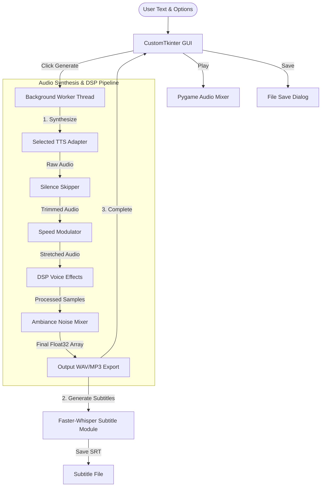
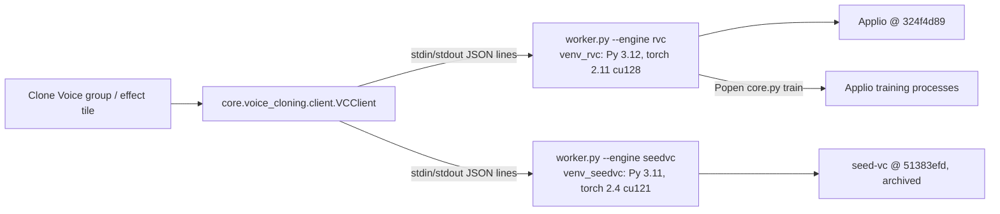

# Adits Voice Studio Developer & Architecture Guide

Welcome to the **Adits Voice Studio** codebase guide. This document serves as a technical manual for developers, designers, and AI agents. It describes the application's structure, explains the system architecture, and provides step-by-step guides on how to extend the platform with new text-to-speech (TTS) engines, audio effects, and customizations.

---

## 📖 Table of Contents
1. [Application Overview](#-application-overview)
2. [File Dictionary](#-file-dictionary)
3. [System Architecture](#-system-architecture)
4. [How to Add a New TTS Engine](#-how-to-add-a-new-tts-engine)
5. [How to Add a New Voice Effect](#-how-to-add-a-new-voice-effect)
6. [Audio Customization Deep-Dive](#-audio-customization-deep-dive)
7. [Clone Voice (RVC and Seed-VC)](#-clone-voice-rvc-and-seed-vc)
8. [Building & Running the App](#-building--running-the-app)
9. [Model Weights & Troubleshooting](#-model-weights--troubleshooting)

---

## 🎙 Application Overview

**Adits Voice Studio** (formerly VoiceCraft TTS Studio) is a modular, desktop-based Text-to-Speech (TTS) Studio built in Python. It provides a premium, responsive dark-themed dashboard using CustomTkinter, allowing users to synthesize high-quality speech from text and apply real-time DSP (Digital Signal Processing) effects. 

### Key Highlights
* **Multi-Engine Support**: Supports cloud-based APIs (Google Translate TTS, Microsoft Edge Neural) and local offline AI models (Kokoro-82M, MeloTTS, Piper TTS, and local system SAPI5 voices).
* **Numpy-Based DSP Pipeline**: Apply 34+ voice effects (Darth Vader, Vocoder 2, Climax, Chorus, Vocoder, Harmonizer Choir, Stutter, Bitcrush, Megaphone, Delay, Plate Reverb, Shimmer Reverb, Reverse Reverb, Robotic, Demonic, Glitch, Reverb, Pitch Shifting, Radio) and curated social media profiles (ASMR Cinematic, SaaS Flash, YouTube Reviewer).
* **Real-time Audio Customizations**: Fine-tune speed, strip silent pauses automatically, mix background ambiance (airplane rumble, forest crickets, or custom imports), and generate synced SRT subtitles.
* **Responsive Architecture**: Decoupled UI widgets and a multi-threaded execution queue ensure that the GUI never freezes during heavy local neural generation.

---

## 📁 File Dictionary

Below is the directory structure mapping each component of the Adits Voice Studio application to its technical role:

| Path | File / Folder Type | Description |
| :--- | :--- | :--- |
| `tts_app.py` | Entry Point Script | The main application entry point. Initializes the CustomTkinter runtime and starts `AditsVoiceStudioApp`. |
| `run.ps1` | Shell Script | PowerShell launcher that automatically checks for and triggers the application via the local virtual environment (`venv_311`). |
| `requirements.txt` | Package Dependencies | Dependencies grouped per engine, plus GUI, playback and DSP libraries. Ends with a note on why `kokoro-onnx` must be installed separately with `--no-deps`. |
| `build_exe.py` | Packaging Script | PyInstaller build of the public release. Bundles only the models the app reads, excludes gTTS/Edge and unused packages, prunes build-only files, writes license notices, then self-tests the frozen EXE. `--installer` also compiles `installer.iss`. Refuses to run from an interpreter that cannot import every engine library, and refuses to bundle truncated Kokoro weights. Outputs `dist/AditsVoiceStudio/AditsVoiceStudio.exe`. |
| `installer.iss` | Inno Setup Script | Packages the `dist/AditsVoiceStudio/` PyInstaller output into a distributable Windows installer (`AditsVoiceStudio-Setup-<version>.exe`) with a GPL license page, Start Menu shortcuts, optional desktop icon, and an uninstaller. |
| `LICENSE.txt`, `licenses/` | Legal | The app is GPL-3.0-or-later. `licenses/` holds the other license texts and `NOTICES_HEADER.txt`, the hand-written top of the generated `THIRD_PARTY_NOTICES.txt`. |
| `assets/`, `tools/make_assets.py` | Branding | App master logo (`logo.png`), icon (`adits_voice_studio.ico`) and splash image (`splash.png`), styled with the app accent color (`#6C63FF`). |
| **`core/`** | Directory | Shared module containing core configuration parameters and system utilities. |
| `├── version.py` | Product Identity | Single source of truth for name, version, publisher and source URL. Bump the version here only. |
| `├── paths.py` | File Locations | `bundle_dir()` (read-only app files), `user_dir()` (`%LOCALAPPDATA%\AditsVoiceStudio`), `output_dir()` (`Documents\AditsVoiceStudio`). Also routes logs to `%LOCALAPPDATA%\AditsVoiceStudio\logs` in the frozen build. On first start after the rebrand, `user_root()` renames an existing `%LOCALAPPDATA%\VoiceCraft` to the new name, so settings, favourites, models and caches carry over. Saved audio in `Documents\VoiceCraft` is left where it is. |
| `├── audio_io.py` | Audio I/O | MP3 encode and non-WAV decode through soundfile's libsndfile, so no ffmpeg is needed. |
| `├── pipeline.py` | Generation Pipeline | `run(request, synth, tmp_dir, cancel_event, progress, status, warn)`: synthesize, skip silences, speed, voice effects, EQ, ambiance, normalize, subtitles, MP3. Takes a `GenerationRequest` of plain settings read on the UI thread and returns a `GenerationResult`; raises `Cancelled`. No UI imports. |
| `├── synth.py` | Synthesizer | `Synthesizer` (`app.synth`): the engine map, `lock` (one `engine.synthesize()` at a time), `engine_kwargs()` and `synthesize(text, tmp_dir, eng_settings)`. Used by generation, the Clone Voice tools and the voice match. |
| `├── voice_selection.py` | Engine Selections | Engine kinds, speed ranges and labels (`format_speed`), `describe_selection`, `synthesis_key`, and resolving a cloned voice's base voice against the engines and voices on offer (`resolve_selection`, `settings_for_selection`). Both engine panels and the Clone Voice code use it; the CTk `EnginePanel` keeps its method names and calls these. |
| `├── defaults.py` | Starting Settings | `engine_settings()`, `customization_settings()`, `active_effects()`: the panels' `get_settings()` values right after start, as plain dicts. The Qt UI generates with them until it has those panels. Keep them equal to the CTk panels' starting values. |
| `├── playback.py` | Playback | `Player`: plays the generated speech on `pygame.mixer.music`. No thread: the UI polls `is_playing()` / `fraction()` from a timer. |
| `├── selftest.py` | Self-test | `AditsVoiceStudio.exe --selftest report.json` runs every offline engine headless and checks real output. |
| `├── constants.py` | Configuration Module | Holds application-wide design tokens (colors, font configurations) and static lists of languages/voices. |
| `├── model_cache.py` | Model Cache | Thread-safe, idle-expiring cache (`MODEL_CACHE`) for heavy TTS/ASR models. Reuses loaded instances between generations and evicts them after 5 minutes idle, returning CUDA memory to the OS. |
| `├── temp_cleanup.py` | Housekeeping | Sweeps orphaned `adits_vs_*` (and pre-rebrand `tts_studio_*`) temp directories left behind by a crash or force-quit. Called on startup. |
| `├── captions.py` | Caption Import | `load_text(path)`: the spoken text of SRT, VTT, ASS/SSA, MicroDVD, SAMI, TTML/DFXP (through `pysubs2`, MIT), YouTube `.sbv` and `.txt` files. Strips timestamps, tags, `[Music]`, all-caps `(LAUGHS)`, `JOHN:` speaker labels and dialogue dashes; drops lines repeated by rolling captions; starts a paragraph after a 2 s pause that follows a full sentence. Reads UTF-8, UTF-16 with BOM, else cp1252. |
| `├── dictation.py` | Live Dictation | Mic (PyAudio, default device, 16 kHz or the device rate resampled) → `StreamVAD` (faster-whisper's Silero model one 512-sample block at a time; matches the whole-file VAD exactly) → `PhraseCutter` (a phrase ends after a 0.6 s pause; past 8 s a 0.2 s pause; at 12 s with no pause it cuts at the quietest block of the last 4 s and carries the rest over) → Whisper base, English, no prompt. Capture and transcription are separate threads. Live text: when no finished phrase waits, the transcribe thread re-reads the phrase in progress with `beam_size=1` every 0.8 s, or 1.5 times the last pass if slower (a pass took 0.35 to 0.75 s for 2 to 12 s of audio on the GTX 1650), and sends it to `on_partial`; `""` clears it. No initial prompt: in tests on two speakers it made Whisper skip words after a cut (word match 91.8% vs 92.2%, and 96.6% vs 98.5%). |
| `├── subtitles.py` | Transcription Module | Word-level subtitle generation wrapper using `faster-whisper`. Manages dynamic GPU/CPU loading and VRAM unloading. `transcribe_file()` transcribes an audio or video file for Text Input with `vad_filter=True` and detected language, calling back per segment; a file Whisper's PyAV decode rejects is retried through `core.audio_io.load_segment()`. |
| `└── voice_cloning/` | Clone Voice (app side) | Manages the voice-cloning runtime and its worker processes. Never imports torch. See [Clone Voice](#-clone-voice-rvc-and-seed-vc). |
| `    ├── runtime.py` | Runtime Manager | Paths, the two runtime venvs, `install()` / `uninstall()`, `runtime.json` manifest, pinned upstream commits. |
| `    ├── client.py` | Worker Client | `VCClient`: one worker per (engine, role), JSON-lines requests, cancel, GPU policy. |
| `    ├── library.py` | Voice Library | `VoiceProfile` and the `voices/<slug>/` folders: create, import, rename, delete. |
| `    ├── pitch.py` | Pitch Matching | Median F0 of the base and target voices, semitone offset. |
| `    ├── previews.py` | Saved Previews | The saved ▶ Preview WAV of each voice in `<root>\previews\`, with a fingerprint of the settings that made it. |
| `    ├── voicematch.py` | Voice Match | Self-maintaining voice bank of English engine voices (engine fingerprints, retries), clip analysis, shortlist. |
| `    ├── tasks.py` | Clone Voice Jobs | The Clone Voice jobs and rules as plain functions: `create_quick`, `train`, `import_model`, `prepare`, `make_preview`, `save_first_preview`, `measure_pitch` / `match_pitch`, `cleanup_preview`, plus `selections`, `length_rule`, `create_estimate`, `active_estimate`, `usable_match`. Jobs run on a worker thread and report through a `TaskContext` (synth, cancel event, progress, temp folders). Both UIs' Clone Voice groups call it. |
| `    ├── estimate.py` | Time Estimates | Training and conversion time estimates shown in the UI. |
| `    └── errors.py` | Exceptions | `VCNotInstalled`, `VCBusy`, `VCCancelled`, `VCWorkerError`, `InstallError`. |
| **`engines/`** | Directory | Contains abstract interfaces and concrete adapters for various TTS engines. |
| `├── base.py` | Class Interface | Declares `BaseTTSEngine`, the abstract base class that all TTS adapters must inherit and implement. |
| `├── registry.py` | Engine Registry | Central registration file (`ENGINE_CLASSES`). Determines which engines are activated and in what order they appear in the UI. |
| `├── gtts_engine.py` | TTS Engine Adapter | Google Translate TTS API wrapper (requires internet connection). Outputs `.mp3`. |
| `├── edge_engine.py` | TTS Engine Adapter | Microsoft Edge Neural Voices API wrapper (requires internet connection). Outputs `.mp3`. |
| `├── kokoro_engine.py` | TTS Engine Adapter | Kokoro-82M adapter with two backends. Prefers local `kokoro-v1.0.onnx` weights to avoid Hugging Face network freezes on startup, and falls back to the PyTorch `KPipeline`. Verifies the weights are complete before loading them. |
| `├── piper_engine.py` | TTS Engine Adapter | Local, offline fast speech engine adapter utilizing `.onnx` voices. |
| `├── melo_engine.py` | TTS Engine Adapter | MeloTTS multi-lingual offline neural engine adapter. |
| `└── pyttsx3_engine.py` | TTS Engine Adapter | Local offline adapter using standard OS speech engines (SAPI5 on Windows). |
| **`effects/`** | Directory | Digital Signal Processing (DSP) files. |
| `├── audio_effects.py` | DSP Library | Static class containing numerical calculations (using NumPy and Librosa) for pitch, speed, vocoders, ambiance mixers, and filters. |
| `├── registry.py` | Effects Registry | Declares `EFFECTS_REGISTRY`, configuring how each voice effect is displayed, toggled, and called. Appends cloned voices at import. |
| `└── cloned_voices.py` | Cloned Voice Effects | Turns each ready voice into a `clone:<slug>` registry entry and converts audio through the worker. |
| **`ui/`** | Directory | GUI presentation layer. |
| `├── app.py` | Core GUI Controller | The main window class `AditsVoiceStudioApp`. Orchestrates the background thread worker, playback systems, and save actions. |
| `├── theme.py` | UI Factory | Helper functions for creating CustomTkinter standard panels, dropdowns, sliders, and switches. `SmoothScrollableFrame` (the right column) eases wheel scrolling: CTk's own handler moves 20 px and redraws on every wheel event, and with about 900 widgets each redraw takes 15 to 20 ms, so fast spins stuttered. |
| `└── panels/` | Directory | Custom panel sub-widgets. |
| `    ├── text_panel.py` | GUI Widget | Renders the text area and updates the live character count. Title bar has 🎤 and **+**. 🎤 starts `core.dictation.Dictation`: the sample (or an empty box) is cleared at once, the phrase being spoken shows as gray live text (tag `dict_live`, written with undo off, left out of `get_text()` and the counter, removed before any undo), and each finished phrase replaces it as its own undo step; the title bar shows Loading / ● Listening / ● Hearing you / ✎ Writing. Click again or Esc stops it, and phrases already heard are still written. `cleanup()` (called from `AditsVoiceStudioApp.destroy()`) closes the mic. **+** is a menu with Import captions or text and Transcribe audio or video. An import replaces an empty box or `SAMPLE_TEXT` without asking, and asks Replace / Append / Cancel over the user's own text (`_ask_mode()`). Each import or transcription is one undo step (Ctrl+Z, `_begin_edit()` / `_end_edit()`). Transcribe opens a media strip under the box: ▶ / ❚❚, seek bar and ✖ (pygame channel 7, file decoded on first ▶), plus progress and Cancel. Segments are added as Whisper finishes them, with the box read-only until the job ends; Cancel keeps the text so far, and a file with no speech or a read error leaves the box as it was. |
| `    ├── engine_panel.py` | GUI Widget | Engine dropdown, GPU toggle, and dynamically swapped configuration screens for each engine. |
| `    ├── effects_panel.py` | GUI Widget | Displays visual toggle cards for each effect registered in the effects registry, in three sub-sections: Favourites, Cloned Voices (with the ✏️ button) and Effects. The ♡ on each card adds a mirror card to Favourites that shares the original's switch variable, so both always show the same state. Favourite keys are saved in `%LOCALAPPDATA%\AditsVoiceStudio\settings\favourites.json`; a deleted cloned voice is dropped from it. |
| `    ├── customization_panel.py` | GUI Widget | Contains speed sliders, silence skipping, background ambiance selectors, sub-tracks, and the Clone Voice group. |
| `    ├── clone_voice_group.py` | GUI Widget | Clone Voice group: install, active-voice settings, voice creation, time estimates, Cancel. |
| `    ├── clone_voice_dialog.py` | GUI Widget | Window opened by the ✏️ button in the Cloned Voices header: rename, change the base voice, speed and sound settings (with ▶ Preview and 🎯 Match), delete. |
| `    ├── analyzer_dialog.py` | GUI Widget | Voice match: one run (bank update, clip analysis, ▶ Result for each shortlisted voice), ranked Best / Close matches with ▶ Original / ▶ Result toggles and Apply, which hands the Result to the next Quick voice as its preview. |
| `    ├── record_dialog.py` | GUI Widget | Microphone recorder for clone clips: device picker, level meter, live waveform, preview with seek, Add to clips. |
| `    ├── timeline_dialog.py` | GUI Widget | Waveform timeline for choosing the part of a clip to clone from (drag, resize, zoom, play). |
| `    └── playback_panel.py` | GUI Widget | Renders the primary action buttons (Generate, Play, Stop, Save MP3, Save SRT, Open Folder) and progress bars. |
| **`ui_qt/`** | Directory | The PySide6 UI being built next to `ui/` (see `docs/pyside6-migration-plan.md`). Started with `tts_app.py --qt` or `ADITS_UI=qt`; `ui/` stays the default until it is done. Has the main window, every panel, the Clone Voice group and its four dialogs. |
| `├── app.py` | Qt Main Window | `MainWindow` and `run()`: header, fixed 50/50 columns, status bar, and the generation, playback and save flow through `core.pipeline`. The right column is a placeholder until the engine, customization and effects panels are ported. |
| `├── theme.py` | Qt Look | One style sheet from `COLORS` / `FONTS` (font sizes as px, like CTk). Buttons get their look from the `role` property. `icon_font()` sets a font the sheet cannot override. |
| `├── bridge.py` | Thread Bridge | `ui(fn, *args)` runs a call on the GUI thread through a queued signal, the Qt counterpart of `after(0, ...)`. Workers must never touch a widget directly. |
| `├── widgets.py` | Shared Widgets | `ToggleSwitch` (drawn like CTkSwitch, text cut with …), `ValueSlider` (float range over QSlider's ints, `set_range()`), `Segmented` (CTkSegmentedButton), `ElidedLabel`, `SeekSlider` (milliseconds; a click on the groove jumps there) and `ask_choice()` (Replace / Append / Cancel style question). |
| `└── panels/` | Directory | `text_panel.py`, `playback_panel.py`, `engine_panel.py`, `customization_panel.py` and `effects_panel.py`, ported from `ui/panels/` with the same behavior and public methods (`docs/ui-parity-checklist.md`). The effects panel keeps one on/off value per key and redraws every switch showing it (tile, Favourites mirror, search row), in place of CTk's shared `BooleanVar`; it reads and writes the same `favourites.json`. In `text_panel.py` the phrase being dictated shows in a gray line under the box, because Qt clears the undo history when undo is switched off. When the card is narrow, `playback_panel.py` puts its six buttons in two rows of three instead of clipping their text. `clone_voice_group.py` (the Clone Voice box; the Active voice picker is a QComboBox with a ♥ delegate), `clone_voice_dialog.py` (✏️ Cloned Voices), `record_dialog.py`, `timeline_dialog.py` and `analyzer_dialog.py` follow their CTk counterparts; their jobs come from `core/voice_cloning/tasks.py`. |
| **`docs/`** | Directory | `pyside6-migration-plan.md` (phases and results) and `ui-parity-checklist.md` (every control of the CTk UI, with possible bugs found). |
| **`vc_runtime/`** | Directory | Code that runs **inside** the voice-cloning venvs and is never imported by the app: `worker.py`, `vc_common.py`, `rvc_backend.py`, `seedvc_backend.py`, `train_site/sitecustomize.py`, and the pinned `requirements-*.txt` / `.lock.txt`. |
| **`vc_runtime_data/`** | Directory (gitignored) | The installed runtime when running from source: venvs, Applio and seed-vc clones, logs, and the voice library. |
| **`models/`** | Directory | Storage for local model files (e.g. Piper `.onnx` files). |
| **`output/`** | Directory | Default folder where audio and subtitles are exported. |

---

## 🏗 System Architecture

Adits Voice Studio utilizes a decoupled, event-driven design. The user interface does not run synthesis operations directly. Instead, generation is offloaded to a worker thread that manages the synthesis and audio processing pipeline before reporting back to the UI.

### 1. Data Flow Diagram



### 2. Multi-Threading & UI Protection
Because neural networks (MeloTTS, Kokoro, Piper) require substantial CPU/GPU compute, running synthesis on the main Tkinter thread would cause the UI to crash or become unresponsive. 
* `_start_generation()` reads every setting on the Tk thread into a `core.pipeline.GenerationRequest`, then starts a daemon thread (`_generate_worker`) that runs `core.pipeline.run()`. The worker never reads a widget. Keep it that way: Qt, the planned next toolkit, crashes on widget access from other threads (see `docs/pyside6-migration-plan.md`).
* Communications back to the UI (e.g. updating progress bars, editing status text, opening error dialogs) are scheduled using the safe Tkinter event loop scheduler `self.after(0, callback, args)`.
* A cancellation signal `self._stop_event` (a `threading.Event`) is periodically checked by the pipeline and the active engine to abort synthesis instantly; the pipeline then raises `core.pipeline.Cancelled`.
* Playback has no thread: `_poll_playback` runs every 50 ms on `after()` and reads `core.playback.Player`.
* Panels and dialogs reach the app only through its public members: `set_status()`, `synth`, `engine_panel`, `text_panel`, `cust_panel`, `system_voices`, `is_generating`, `refresh_cloned_voices()` (plus Tk's `after()`). Do not add new uses of its private `_` members.

---

## 🔌 How to Add a New TTS Engine

Adding a new engine requires creating an adapter class and registering it. 

### Step 1: Create the Adapter Class
Create a new file under `engines/my_new_engine.py` and implement the two mandatory abstract methods from `BaseTTSEngine`:

```python
"""
engines/my_new_engine.py
"""
import os
from engines.base import BaseTTSEngine

# Try importing the engine's external libraries
try:
    import my_cool_tts_library
    _AVAILABLE = True
except ImportError:
    _AVAILABLE = False


class MyCoolEngine(BaseTTSEngine):
    # Unique label shown in the UI dropdown
    name = "My Cool TTS Engine (Local AI)"

    @staticmethod
    def is_available() -> bool:
        """Return True if the engine's libraries and models are ready to load."""
        return _AVAILABLE

    def synthesize(self, text: str, tmp_dir: str, **kwargs) -> dict:
        """
        Synthesize text and write the output file into the temp directory.
        
        Parameters
        ----------
        text : str
            The input text to speak.
        tmp_dir : str
            A temporary directory to write files.
        **kwargs : dict
            Settings passed from the UI (e.g. rate, speed, voice_key).
            
        Returns
        -------
        dict with keys:
            playback_file: str - path to the file used by pygame for playback
            save_file: str     - path to the file offered for saving
            save_ext: str      - default file extension (e.g. ".wav", ".mp3")
        """
        status_cb = kwargs.get("status_cb", None)
        voice_id = kwargs.get("voice_key", "default_voice")

        if status_cb:
            status_cb("Running cool synthesis...")

        output_path = os.path.join(tmp_dir, "cool_output.wav")
        
        # Call the third-party synthesis API
        my_cool_tts_library.speak_to_file(text, output_path, voice=voice_id)

        return {
            "playback_file": output_path,
            "save_file": output_path,
            "save_ext": ".wav"
        }
```

### Step 2: Register in `engines/registry.py`
Import the new engine adapter and append it to `ENGINE_CLASSES`:

```python
# engines/registry.py
# ...
from engines.my_new_engine import MyCoolEngine  # Add this

ENGINE_CLASSES = [
    GTTSEngine,
    EdgeEngine,
    KokoroEngine,
    PiperEngine,
    MeloEngine,
    Pyttsx3Engine,
    MyCoolEngine,  # Add this
]
```

### Step 3: Add UI Configurations (Optional)
If your engine has specific settings (e.g., custom voice maps or speed parameters):
1. **Define Constants**: Add voice directories to [constants.py](file:///e:/Develop/Antigravity_testing/tts_app%20modular/core/constants.py).
2. **Build Settings Frame**: Open [engine_panel.py](file:///e:/Develop/Antigravity_testing/tts_app%20modular/ui/panels/engine_panel.py). Add a `_build_my_cool_engine_frame()` method mimicking existing builders, storing widgets in `self._sub_frames["my_cool_engine"]`.
3. **Register Switcher**: Add your engine's string identifying keyword into `key_map` inside the `_on_engine_change()` method.
4. **Collect Settings**: Update `get_settings()` to include your new GUI widget values in the returned dictionary.

---

## ✨ How to Add a New Voice Effect

Adding a voice effect is entirely configuration-driven. The GUI automatically builds the cards and checkbox bindings based on the central registry.

### Step 1: Implement the DSP Method
Open [audio_effects.py](file:///e:/Develop/Antigravity_testing/tts_app%20modular/effects/audio_effects.py). Add a static method that receives float32 NumPy samples, processes them, and returns a modified float32 NumPy array:

```python
# effects/audio_effects.py
# ...
class AudioEffects:
    # ... (existing effects)

    @staticmethod
    def alien_vibrato(samples, sr, rate_hz=6.0, depth=0.4):
        """
        Creates a modulating frequency shifter (vibrato effect).
        """
        n = len(samples)
        t = np.arange(n, dtype=np.float32) / sr
        
        # Sine wave LFO
        lfo = np.sin(2 * np.pi * rate_hz * t) * depth
        
        # Naive ring-like modulation to create pitch vibes
        modulated = samples * (1.0 + lfo)
        
        # Always normalize output to prevent digital clipping
        mx = np.max(np.abs(modulated))
        if mx > 0:
            modulated = modulated / mx * 0.9
            
        return modulated.astype(np.float32)
```

### Step 2: Register in `effects/registry.py`
Open [registry.py](file:///e:/Develop/Antigravity_testing/tts_app%20modular/effects/registry.py) and insert your new effect dictionary into `EFFECTS_REGISTRY`:

```python
# effects/registry.py
# ...
EFFECTS_REGISTRY = [
    {
        "key":    "alien_vib",
        "label":  "👽  Alien Vibrato",
        "desc":   "Modulating vibrato filter",
        "fn":     AudioEffects.alien_vibrato,
        "kwargs": {"rate_hz": 8.0, "depth": 0.5}, # Optional: Override defaults
    },
    # ... (Keep normalization at the very bottom)
]
```

The app will dynamically render the toggle switch, wire the `BooleanVar` state, and execute the DSP function in the order specified in the registry.

---

## 🎧 Audio Customization Deep-Dive

Adits Voice Studio implements a post-processing pipeline that runs sequentially in the following order:

1. **Silence Skipping** (if enabled; crops silent periods using `pydub`)
2. **Speed Adjustment** (if speed is non-default; resamples or uses phase vocoder)
3. **Voice Effects Loop** (applies enabled effects from `EFFECTS_REGISTRY` sequentially, skipping the `normalize` step for later execution)
4. **Background Ambiance Mix** (if enabled; mixes in synthetic or custom audio soundscapes)
5. **Normalization Pass** (if enabled; executed at the **very end** of the pipeline so that the combined speech + effects + ambiance signal is properly scaled to a peak level of $-3.0dB$ without clipping)

Here is how each step operates:

### 1. Skip Silences
* **Module**: `core/pipeline.py` (`run`)
* **Mechanism**: Uses `pydub.silence.split_on_silence` with a threshold of `-40 dB` and a minimum silence duration of `200ms`. Speech chunks are identified, extracted, and concatenated. This removes unnatural pauses generated by local neural networks.

### 2. Time-Stretching (Speed Adjustment)
* **Module**: [audio_effects.py](file:///e:/Develop/Antigravity_testing/tts_app%20modular/effects/audio_effects.py) (`change_speed`)
* **High Quality (Default)**: If `librosa` is installed, it utilizes **Phase Vocoder** time-stretching (`librosa.effects.time_stretch`). This speeds up or slows down the narration *without* altering the pitch or voice timbre.
* **Low Quality (Fallback)**: If `librosa` is missing, it falls back to basic linear interpolation `np.interp`, resulting in a pitch shift (e.g., faster speeds sound high-pitched and "chipmunk-like").

### 3. Background Ambiance Mixer
* **Module**: [audio_effects.py](file:///e:/Develop/Antigravity_testing/tts_app%20modular/effects/audio_effects.py) (`add_environment_sound`)
* **Synthetic Tracks**: 
  * *Airplane Cabin*: Blends deep, low-passed engine rumble (LPF at $70Hz$, $55\%$), muffled air cabin flow whoosh (LPF at $200Hz$, $35\%$), and a soft turbine engine hum harmonic series ($75Hz$, $150Hz$, $225Hz$, $10\%$) to mimic insulated airline acoustics rather than high-frequency television static.
  * *Nature/Forest*: Blends gentle pink noise wind with a high-frequency carrier sine ($4200Hz$) modulated at $3Hz$ to simulate cricket chirps.
* **Custom Imports**: Reads an uploaded file (`.wav`, `.mp3`), resamples it to match the main TTS stream, loops it if it is shorter than the speech track, and mixes the channels using a soft-clipping factor:
  $$\text{Mix} = \text{Speech} + \text{Ambiance} \times \text{Volume}$$
  If the combined signal clipping threshold ($1.0$) is breached, it divides the array by the max amplitude to prevent harsh digital distortion.

---

## 🧬 Clone Voice (RVC and Seed-VC)

Clone Voice turns recordings of a target speaker into a new tile under **Voice
Effects → Cloned Voices**. With that tile on, every generated clip is converted
into the target voice before the other effects run.

There are three ways to make a voice:

| Mode | Engine | Needs | Ready in |
| :--- | :--- | :--- | :--- |
| Quick | Seed-VC (zero-shot) | 3 to 25 s of clean speech | seconds |
| Train (RVC) | Applio | 1+ min of speech, 3+ min recommended | minutes to hours |
| Import model | Applio | an RVC `.pth`, optional `.index` | seconds |

### Using it in the app

* **Customization → Clone Voice → Active voice:** pick a voice (this switches its
  tile on), then tune it. The picker opens `_VoiceList`, a scrolling list
  (12 rows tall, ♥ beside each favourite) in place of CTk's `tk.Menu`, which
  has no scrollbar on Windows. The ♡ after the picker adds the shown voice to
  Favourites or removes it, like the heart on its tile; it follows changes
  made there through `EffectsPanel.subscribe_favourites()`. RVC voices have Pitch (with 🎯 Match), Index rate and
  Protect. Quick voices have Quality steps. The estimate line shows how long the
  current text will take. ▶ Preview plays the voice's saved preview (or makes
  it); while it plays the same button reads ■ Stop and stops it. It also resets
  when the audio ends, another voice is switched on, or another sound takes
  pygame channel 2.
* **Customization → Clone Voice → Create voice:** name, mode, clips (or a model
  file), and for training Epochs, Batch and Sample rate. The estimated time
  updates as the options change. One progress row with ✖ Cancel serves install,
  creation, training, preview and pitch matching.
* **Layout.** Each tab is a set of tiles (`_tile()`): Voice and Sound on Active
  voice; New voice, Recordings (or Model files), Clean-up and Training on Create
  voice, then the estimate and 🧬 Create Voice. `_layout()` puts two tiles per
  row when the box is at least `WIDE_PX` (600 unscaled px) wide, else one; a tile
  alone in its row spans the box, and Clean-up then shows its three options side
  by side. ▶ Preview moves under the base voice for RVC voices so both tiles end
  level. Explanations are hover tips (`_Tip`), not notes under the controls.
  Never grid an empty `CTkFrame`: it keeps its default 200 px height.
* **Voice Effects → Cloned Voices → ✏️:** rename or delete voices, or change a
  voice's settings. **🔊 Voice settings ▾** opens an editor in the row: the base
  (engine, Kokoro language, voice, speed) and the sound sliders of the Clone
  Voice box (RVC: Pitch with 🎯, Index, Protect; Quick: Quality). **▶ Preview**
  speaks `PREVIEW_TEXT` with the editor's values, saved or not, and converts it
  into the clone. **🎯** measures the editor's base voice (not the TTS Engine
  card) against the clips and sets Pitch; it needs an RVC voice with clips. The
  row's **Save** writes the name, base and sound together, and
  `CloneVoiceGroup.reload_active()` shows them in the Clone Voice box when the
  voice is switched on. Synthesis settings come from
  `EnginePanel.settings_for_selection()`, so the TTS Engine card does not change
  until a base is saved for the voice that is switched on. Only one preview or
  pitch match runs at a time; its button turns into Cancel. Unfinished and
  failed voices are listed too, so they can be cleaned up; only ready voices
  preview.
* **Saved previews** (`core/voice_cloning/previews.py`). Each voice's ▶ Preview
  is kept as `<root>\previews\<slug>.wav` plus `<slug>.json` holding a
  fingerprint: the preview text, `EnginePanel.synthesis_key()` of the engine
  settings that spoke it, the sound settings and the model file's size and
  time. ▶ Preview (Clone Voice box and ✏️ window) plays the saved file at once
  when the fingerprint of the request matches, and otherwise makes a new one,
  which is saved only when it uses the voice's saved base and sound
  (`CloneVoiceGroup.saved_fingerprint()`). Creating a voice saves its first
  preview as the last step (Cancel or a failure there keeps the voice). After
  a voice match with the same clips and base voice, the first 10 s of the
  applied ▶ Result (`previews.cut_preview()`, cut in the last pause) are
  transcribed once (`previews.transcribe()`) into `profile.preview_text`; a
  Quick voice keeps that audio as its preview, since the analyzer cloned it
  the same way, and a trained voice speaks the words with its model. Without a
  match, `preview_text` stays empty and previews say `previews.TEXT`. Every
  remake speaks `previews.text_of(p)`, which is also part of the fingerprint. Saving
  a new base or sound in the ✏️ window keeps the preview just heard when it
  matches, or else deletes the old one and runs `refresh_preview()` as a
  "Preview update" task. Slider moves in the Clone Voice box and **Use current**
  only make the saved one stale; the next ▶ Preview replaces it.
  `library.delete_voice()` deletes the preview. From source the folder is
  `vc_runtime_data\previews\` (gitignored); the installed app keeps it under
  `%LOCALAPPDATA%`, since the install folder is read-only. Voices without a
  usable base (imported models before **Use current**) get no saved preview.
* Settings are saved to the voice's `profile.json` as the sliders move.
* **🎙 Record** (between Add clips and Clear) opens `RecordDialog`: pick a
  microphone (default host API, default device first), record with a live level
  meter and waveform (auto-stop at 10 minutes), then preview with ▶/⏸, a seek
  slider or a click on the waveform, and **Add to clips**, **Record again** or
  **Discard**. Takes are 16-bit mono WAV in `<root>\recordings\` (gitignored with
  the runtime root) and become normal clips, so trim and cleanup apply to them.
  Capture uses PyAudio (`requirements.txt`, and `_REQUIRED` in `build_exe.py`).
* **Clip player** (Recordings tile, under Auto / Male / Female, shown once a clip
  is added): ▶ / ❚❚, a menu of the added clips, the time, and a seek bar. It
  plays the whole file (not only the trimmed part) on pygame channel
  `CLIP_PLAY_CHANNEL` (6; channels 1 to 5 are ambiance, previews, timeline,
  recorder and analyzer). The clip is decoded on a thread on its first ▶ and
  kept until another clip is picked; seeking replays from the new point, as in
  `RecordDialog`. Switching tabs pauses it; Clear and app close stop it.
* **Base voice.** A clone sounds best when converted from the engine voice it was
  made with. Creating a voice stores the TTS Engine dropdown values in
  `profile.base_selection` (engine, Kokoro language, voice, and speed: Kokoro /
  Melo speed, Edge rate, pyttsx3 WPM; Piper and gTTS have none). Switching the
  voice on, from its tile or the picker, calls
  `EnginePanel.apply_voice_selection()`, which restores all of it and reports why
  if it cannot (engine missing, voice missing); nothing changes in that case. The
  user can still change engine, voice or speed afterwards. **Use current** saves
  the current selection as the base (for imported models, or to re-base a voice).
  Voices made before this field existed fall back to `base_engine` / `base_voice`
  and keep the current speed.
* Clip formats: `core.audio_io.AUDIO_EXTENSIONS` (WAV, MP3, M4A, AAC, MP4, FLAC,
  OGG/OGA, Opus, WebM, WMA, AIFF, CAF, AMR, 3GP). `load_segment()` tries
  libsndfile first and falls back to PyAV for AAC, WebM, WMA, AMR and 3GP. PyAV
  bundles its own FFmpeg libraries and already ships with the app because
  faster-whisper needs it, so no ffmpeg install is required.

### Preparing clips (optional)

Three switches on the Create voice tab, all off by default. With either on,
`library.prepare_clips()` writes a copy of every clip to `voices/<slug>/processed/`
first, and cloning reads those copies (`clip["used"]`). The originals in
`clips/` are never changed.

* **Use part of each recording.** Presets count recording time from the start
  of the first clip and continue into the next clip: Quick has 10 / 20 /
  25 s (Seed-VC reads at most 25 s), Train has 1 / 3 / 5 min. **Custom**
  lists every clip with a ✂ Edit button that opens `TimelineDialog`: drag the
  selection to move it, drag its edges to resize, drag on empty waveform (or
  anywhere when the whole clip is selected) for a new selection, − / + / Fit
  zoom, wheel pans, Ctrl+wheel zooms, typed Start / End, quick lengths, and
  ▶ Play selection with a playhead. Ranges are stored per clip as `start` / `end`
  seconds in `profile.json`.
* **Remove music & noise.** Runs Demucs (`htdemucs`) in the RVC
  worker (`cmd: "separate"`) and keeps the vocal stem; the optional checkbox
  adds `noisereduce` (stationary) for hiss and hum. **Preview cleanup** separates
  up to 30 s of the first selection and offers ▶ Original / ▶ Cleaned. Pitch
  matching measures the cleaned audio.
* **Skip silences.** Applied last, to the trimmed and cleaned audio: pauses
  longer than 0.4 s are removed (threshold 16 dB under the clip's average,
  never above -40 dBFS, 150 ms kept around each phrase). Order: trim, remove
  music / noise, skip silences. Stored as `prep.skip_silences`.

Measured on `Voices-training\BLJ Voice over.mp3` (68.9 s, voice over music): the
voice stem transcribed the same as the original; music-only stretches dropped
to about -70 dB, so the reference builder's silence removal discards them
(0 to 36 s became 14.3 s of speech). Separation took 10.1 s for 68.9 s warm, plus
about 1.2 GB GPU memory. The first use downloads about 81 MB of weights.

Demucs choice: the PyPI package `demucs==4.1.0` is published from
`github.com/adefossez/demucs` (the maintained fork; the facebookresearch repo is
archived at v4.0.1). It adds only julius, lameenc and sphn. Weights load from
Hugging Face `adefossez/HTDemucs` into `$HF_HOME` (the runtime root), with Meta's
server only as a fallback. `audio-separator` was rejected because it upgrades
torch to 2.14, which breaks the Applio pin.

When `vc_runtime/requirements-<engine>.txt` changes, `runtime.needs_update()`
compares it with the manifest and the Clone Voice header shows **⬆ Update**,
which re-runs `install()` for that engine only (33 s here; pip skips what is
present).

### Voice match (🔍 Analyze)

Clickable once a clip is added, between Record and Clear. One click runs
everything and shows the result: the English engine voice that clones best
from the clip, to use as the base voice.

1. **Voice bank update.** Every English local voice (Kokoro American and
   British, MeloTTS English accents, Piper, English system voices; 36 here) has
   a sample of `voicematch.SENTENCES["en"]` at speed 1.0 in
   `<root>\voice_bank\`, with its CAMPPlus voiceprint (Seed-VC worker
   `cmd: "embed"`, CPU), median F0 and articulation rate. Only what changed is
   redone, automatically:
   * a voice not in the bank yet (new system voice, new Kokoro voice);
   * a voice whose engine fingerprint changed (`engine_fingerprint()`: engine
     package versions, Kokoro's model and voice-pack files, each Piper model
     file, the system voice id), so an engine update re-samples only that engine;
   * a voice that failed under an older app version (retried once per
     `core.version.__version__`; a failure in the current version is not retried).
   Voices no longer offered are pruned. Entries from before fingerprints existed
   adopt the current one instead of being rebuilt. There is no manual rebuild.
2. **Clip analysis** of the selected audio (after trim, and after music removal
   when that is on), up to `MAX_ANALYSIS_SECONDS` (25 s): pitch with a rough gender guess, speaking
   speed and language (faster-whisper, `core.subtitles.get_whisper_model`), and
   voiceprint.
3. **Gender.** The **Auto / Male / Female** row under the Recordings buttons
   (default Auto) picks which bank voices are compared. Male and Female are the
   user's choice. Auto (`voicematch.decide_gender()`) uses the clip's pitch when
   it is clear (under 145 Hz male, over 180 Hz female), and otherwise the
   voiceprint: the mean similarity of the 3 closest male bank voices against
   the 3 closest female ones. A gap under 0.02 compares all voices.
   A bank voice's gender comes from what is known about it
   (`voicematch.voice_gender()`: Kokoro `af_` / `am_` / `bf_` / `bm_`, Piper
   dataset name, MeloTTS English, Windows voice names), and from its pitch only
   when nothing is known. Pitch alone is not enough: `af_alloy` measures 142 Hz,
   `am_eric` and `am_santa` 154 to 155 Hz.
   The clip's pitch is marked unsteady when over 30% of its voiced frames sit
   under 75 Hz (pYIN's floor is 65 Hz); its pitch is then the median of the
   frames above that, and Auto does not use it. Measured: `Video-8115.mp4` and
   `Radio-voice.mp3` had 54% and 63% of frames at the floor and read as about
   70 Hz "likely male", while their voiceprints were clearly female.
4. **Shortlist:** the 3 voices of that gender with the highest voiceprint
   similarity minus 0.015 per semitone of pitch difference.
5. **Results and rank:** each shortlisted voice speaks the clip's Whisper
   transcript at its suggested speed (`voicematch.speak()`), and the speech is
   cloned with Seed-VC using the clip (silences removed, 25 s) as the
   reference. Each Result's voiceprint is compared with the clip, minus the same
   pitch penalty (the converted result takes the clip's timbre whatever the
   source, so similarity alone does not tell the sources apart by pitch). Rows
   are ordered by that score: **1. Best match**, then **2.** and **3. Close
   match**. A voice whose Result fails is listed after the others. With no
   words in the clip, or no Result at all, the shortlist order is kept and the
   window says so. The ranking shows once all Results are made; Cancel stops
   the whole run.

The bank recordings are only used for the shortlist; a run speaks and clones
nothing else (before 2026-10-13 it also test-cloned the bank sentence for each
voice, ▶ Sample, and played the bank recording, ▶ Base). Each row shows pitch
against the clip and a suggested speed (Kokoro / Melo speed, pyttsx3 WPM) so
the voice talks at the clip's pace, and two play / stop toggles on one channel:

* **▶ Original**: the clip as it was analyzed (trimmed, and cleaned when music
  removal is on, up to 25 s).
* **▶ Result**: the clip's words in that voice, cloned, to compare word for
  word with Original.

**Apply** calls `EnginePanel.apply_voice_selection()`, passes the Result to
`CloneVoiceGroup._on_match_applied()` (which copies it out of the analyzer's
temp folder) and closes the window; the controls stay editable. When a voice is
then created from the same clips, clean-up switches and base voice
(`_usable_match()`, which compares `EnginePanel.synthesis_key()`), the first
10 s of that Result become its saved preview (see Saved previews).

Measured on the Arjun clip with the older test-clone ranking (bank already
built): about 2.3 minutes per run; test-clone scores were 0.88 to 0.91 against
0.60 to 0.70 before cloning. Seed-VC is not deterministic, so near-equal
candidates can swap places between runs.

* English only by design; the window warns when Whisper hears another language.
* MeloTTS French fails in the app venv (its BERT checkpoint needs torch 2.6+)
  and Kokoro Chinese fails (espeak has no "zh"). Both predate this feature, so
  the bank skips non-English voices rather than download gigabytes onto C:.
* Seed-VC's backend sets `HF_HUB_CACHE` to `seed-vc\checkpoints\hf_cache` at
  start. Without it, running `embed` before `convert` made huggingface_hub use
  `$HF_HOME`, and the conversion models were downloaded a second time.

### Architecture

The cloning engines need versions of torch, numpy and transformers that clash
with each other and with the app. They therefore run in **two separate venvs**,
in **separate processes**, and the app talks to them over JSON lines.



* The app never imports torch for cloning. `core/voice_cloning/` is standard
  library only at import time, so startup and `--selftest` are unaffected when
  the runtime is missing.
* One worker per (engine, role): `("rvc","convert")`, `("seedvc","convert")`,
  `("rvc","train")`. Only one convert worker is alive at a time (4 GB GPU),
  training stops every convert worker, and conversions raise `VCBusy` while a
  voice trains.
* Overlapping jobs (a generation, the analyzer, previews, clean-up) queue
  instead of failing. Each worker runs one request at a time (`_Worker.busy`).
  A worker that must make way for the other engine is stopped only after its
  running request ends (`VCClient._worker` waits outside the client lock, so
  `is_warm()` on the Tk thread never blocks), and a queued request whose worker
  was stopped meanwhile starts it again (`_WorkerGone`, retried by
  `VCClient._request`). Waiting still honours Cancel, and status callbacks get
  `client.WAITING`. Before 2026-10-13 the switch killed the running request
  ("The Seed-VC convert worker stopped unexpectedly" when the analyzer's music
  removal started during a generation). Each switch reloads the other model,
  so overlapping jobs on different engines take longer; results are unchanged.
* Workers exit after 5 minutes idle, when the app closes their stdin, or on
  `shutdown`. `AditsVoiceStudioApp.destroy()` calls `shutdown_client()`.
* `core.synth.Synthesizer.lock` (`app.synth`) serializes every `engine.synthesize()` call,
  because the Clone Voice tools and the voice match synthesize too (base sample, preview, bank).

### Where things live

| What | From source | Installed EXE |
| :--- | :--- | :--- |
| Runtime root | `vc_runtime_data/` in the repo | `%LOCALAPPDATA%\AditsVoiceStudio\vc_runtime` |
| Override | `%LOCALAPPDATA%\AditsVoiceStudio\settings\clone_voice.json` with `{"runtime_root": "E:\\..."}` | same |
| Manifest | `<root>\runtime.json` (one verified entry per engine) | same |
| Logs | `<root>\logs\install.log`, `worker-rvc.log`, `worker-rvc-train.log`, `worker-seedvc.log` | same |
| Voices | `<root>\voices\<slug>\` | same |

A voice folder holds `profile.json` (schema 1: name, mode `rvc|seedvc`, status
`draft|training|ready|failed`, pitch, index_rate, protect, diffusion_steps,
base voice and F0 values), `clips/`, `reference.wav` (Quick) or
`model/<slug>.pth` + `.index` (RVC), and `samples/`. Paths inside the profile
are relative, so the whole root can be moved.

### Installing the runtime

Click **Install voice cloning** in Customization → Clone Voice, or run:

```powershell
.\venv_311\Scripts\python.exe -c "from core.voice_cloning import runtime; runtime.install(progress_cb=lambda f,m: print(f'{f:.2f} {m}'), log_cb=print)"
```

Requirements: Python 3.12 and 3.11 reachable through the `py` launcher, Git,
about 9 GB of downloads and about 21 GB free on the runtime drive. Each step is
skipped when already done, so re-running repairs a broken install:

1. Create `venv_rvc` / `venv_seedvc` with the `py` launcher.
2. Install torch from the CUDA index, then `vc_runtime/requirements-<engine>.txt`
   (stamped by sha256, then `pip check`). `requirements-<engine>.lock.txt` records
   the exact versions that were verified.
3. Shallow-fetch Applio and seed-vc at the commits pinned in `runtime.ENGINES`.
4. Applio only: copy `assets/config_template.json` to `assets/config.json`, run
   `core.py prerequisites`, and check each base model against the sizes in
   `runtime.APPLIO_MODELS`. Mismatches are deleted and fetched once more.
5. Run each worker with `--selfcheck` (Seed-VC downloads about 1.8 GB here) and
   write the manifest. The pip cache (about 5 GB) is deleted at the end.

The installed EXE cannot create venvs yet, so the group shows "Not available in
this build". `build_exe.py` still bundles `vc_runtime/` as data so a later
release can install from the EXE.

### Worker protocol

Requests: `{"id", "cmd": "ping" | "selfcheck" | "convert" | "inspect" | "train" | "cancel" | "shutdown", ...}`.
Events: `{"event": "ready"}` once, then per request `progress` (stage,
fraction, message, epoch, total_epoch, eta_seconds), `log`, `done` (result) or
`error` (kind `oom | ram | cancelled | dataset_too_small | not_found | bad_model | generic`, message, hint).

A cancel is sent to the worker. If it has not answered in 8 s (an in-process
conversion cannot be interrupted), the client kills the worker tree with
`taskkill /F /T`, and it respawns on next use. Training cancels in under a second.

### How a cloned voice joins the effects

`effects/registry.py` calls `extend_with_cloned_voices(EFFECTS_REGISTRY)` at
import. Each ready voice becomes an entry right after `normalize` with
`exclusive_group: "clone"`, so conversion runs before every other DSP effect.
`EffectsPanel` shows these entries in the Cloned Voices grid and the rest in the
Effects grid. `ui/app.py` holds the same list object, so
`refresh_cloned_voices()` changes it **in place**; never rebind it. After any
library change call `app.refresh_cloned_voices(select=slug)`, which also re-syncs
the tiles and the Clone Voice picker.

In `core.pipeline.run()`, a clone entry gets `cancel_event` and `status_cb`, plus
the Customization slider values from `cust_settings["clone_voice"]` when its slug
matches. A clone failure other than Cancel is not fatal: the clip keeps the
engine voice, and the final status shows why instead of "success".

### Pitch matching and time estimates

RVC keeps the input's pitch contour, so a high engine voice converted into a
low target sounds wrong. **Match pitch** synthesizes `pitch.BASE_SENTENCE` with
the current engine voice and sets `12 * log2(target F0 / base F0)`, clamped to
plus or minus 24 semitones. Measured: Kokoro `af_heart` at 191 to 200 Hz, a deep
male target at 84 Hz, offset -14.

`core/voice_cloning/estimate.py` holds the estimates, calibrated on a GTX 1650
(4 GB) with 14 GB RAM:

| Job | Measured |
| :--- | :--- |
| RVC training, 94 s audio, 3 epochs, batch 2 | 358 to 365 s total, about 31 s per epoch |
| RVC conversion, 8 s of speech | 2.2 s warm, about 35 s more on first use |
| Quick conversion, 8 s of speech, 10 steps | 18 s warm, about 40 s more on first use |

Batch 1 and the 32 / 48 kHz factors are guesses. During training the time left
comes from the measured epoch times instead.

### Lessons from bring-up (keep these)

* **Windows stdin deadlock.** While one thread blocks reading a stdin pipe,
  loading a DLL with a static C runtime (for example `import numpy`) blocks too.
  `worker._detach_stdin()` moves the request pipe to a private handle and points
  standard input at NUL. Never read requests from fd 0 directly.
* **RAM, not VRAM, limits training on 14 GB.** Applio hardcodes
  `DataLoader(num_workers=4, prefetch_factor=8)`, and each loader worker loads
  all of torch (about 2 GB commit). One run died with MemoryError.
  `vc_runtime/train_site/sitecustomize.py` is put on `PYTHONPATH` for training
  only and caps the workers at `VC_MAX_LOADER_WORKERS` (default 0). Peak commit
  fell from 34.5 GB to about 29 GB with no slower epochs. Applio's files are not
  edited.
* **Applio quirks.** Without `assets/config.json`, training "succeeds" but writes
  no model, so success is judged by the `<name>_<E>e_<S>s.pth` file, not the exit
  code (train.py exits 2333333 on success and on "not enough data").
  `convert_audio()` returns silently on a missing model and replaces "trained"
  with "added" anywhere in the index path, so the backend checks files and
  copies such indexes to a neutral path. Models load with `weights_only=True`.
* **GTX 16xx has no tensor cores.** Seed-VC at fp32 with 10 steps ran about 7x
  faster than its fp16 / 30-step default, with the same transcript.
* **sm_75 is the oldest arch in torch 2.11 cu128.** Keep Applio pinned; a newer
  torch may drop the GTX 1650.
* A venv's `python.exe` on Windows is a launcher that starts the real
  interpreter as a child. Always kill with `/T`.
* Never name a method `_w` on a Tk or CustomTkinter widget subclass. Tk stores
  the widget's path name in `self._w`, so the method replaces it and drawing
  fails with "'str' object is not callable".
* `CustomizationPanel.cleanup()` also runs when the ambiance choice changes, so
  clone cleanup is called from `AditsVoiceStudioApp.destroy()`, not from there.

### Troubleshooting

| Symptom | Check |
| :--- | :--- |
| "Not installed" after an install | `<root>\runtime.json` must have `"verified": true` for both engines. Read `<root>\logs\install.log`. |
| A conversion fails | `<root>\logs\worker-<engine>.log` has the full traceback. |
| Training stops with "ran out of memory (RAM)" | Close browsers and IDEs. Keep `VC_MAX_LOADER_WORKERS` at 0. |
| Training stops with "Out of GPU memory" | Lower the batch size (2, then 1). |
| A stray `python.exe` after closing | `Get-CimInstance Win32_Process -Filter "Name='python.exe'"`, look for `worker.py` or `core.py`, then `taskkill /F /T /PID <pid>`. |
| Music removal says the package is not installed | Press **⬆ Update** in Clone Voice (adds `demucs` to `venv_rvc`). |
| Base models look damaged | Delete the file under `<root>\Applio\rvc\models\...` and run the install again. |
| Start over | Delete `<root>\runtime.json` (keeps everything, re-verifies) or call `runtime.uninstall()` (keeps `voices/`). |

### Licenses

Applio is MIT and Seed-VC is GPL-3.0; both are compatible with this app's
GPL-3.0-or-later license. Neither is bundled: the runtime installer downloads
them, so they do not appear in `THIRD_PARTY_NOTICES.txt`. Seed-VC's repository
was archived on 2025-11-21, and its models download from Hugging Face on first
use.

---

## 🛠 Building & Running the App

### Running Locally
To launch the application from source code:
1. Ensure Python 3.11 is installed.
2. Initialize your virtual environment:
   ```powershell
   python -m venv venv_311
   .\venv_311\Scripts\python.exe -m pip install -r requirements.txt
   .\venv_311\Scripts\python.exe -m pip install --no-deps kokoro-onnx
   ```
   > **Always call the venv interpreter by path.** On this machine bare `python`
   > is 3.13 and `venv_311\Scripts\pip.exe` still points at the venv this one was
   > copied from, so `pip install ...` lands in the wrong environment and the
   > package appears missing to the running app.
3. Run the powershell script to boot the application:
   ```powershell
   .\run.ps1
   ```

### Compiling to Portable EXE
You can package Adits Voice Studio into a standalone Windows directory:
1. Run [build_exe.py](file:///e:/Develop/Antigravity_testing/tts_app%20modular/build_exe.py) **with the venv interpreter**:
   ```powershell
   .\venv_311\Scripts\python.exe build_exe.py
   ```
   PyInstaller bundles whatever the *running* interpreter can import, so a bare
   `python build_exe.py` silently produces an EXE without Kokoro, Piper, MeloTTS
   or subtitles. `_check_interpreter()` now aborts the build and names the
   missing packages rather than shipping a partial bundle.
2. The build runs PyInstaller with `--collect-all` for the heavy libraries, then:
   * bundles only the model files the app reads: `kokoro-v1.0.onnx`, `voices.bin`, each voice in `PIPER_VOICES` (with its `.MODEL_CARD`), and `Systran/faster-whisper-base` so subtitles work offline. The repo's `models/kokoro` and `models/voices` (PyTorch weights no code reads) are no longer shipped;
   * excludes `gtts` and `edge_tts`, so the public build has no online engines, plus unused packages the dev venv holds (`_EXCLUDE`);
   * stamps version, icon and splash screen into the EXE;
   * prunes build-only files (`torch/lib/*.lib`, headers, C sources, pygame tests);
   * writes `LICENSE.txt`, `THIRD_PARTY_NOTICES.txt` and `licenses/` into the app folder;
   * bundles `vc_runtime/` (worker scripts and pinned requirements) as data, but no cloning libraries;
   * runs `AditsVoiceStudio.exe --selftest` and stops if any offline engine produces no audio.
3. Once completed, the distribution is saved in the `./dist/AditsVoiceStudio/` folder (dominated by the CUDA build of PyTorch). Run `AditsVoiceStudio.exe` to launch the portable app.

### Building a Windows Installer (Setup.exe)
For end users, a proper installer is preferable to distributing the raw portable folder. [installer.iss](file:///e:/Develop/Antigravity_testing/tts_app%20modular/installer.iss) is an [Inno Setup](https://jrsoftware.org/isinfo.php) script that wraps the PyInstaller output into a single `Setup.exe`.

1. Install Inno Setup 6 (one-time): `winget install JRSoftware.InnoSetup`.
2. Bump `__version__` in `core/version.py`.
3. Build app and installer in one step:
   ```powershell
   .\venv_311\Scripts\python.exe build_exe.py --installer
   ```
   Or compile only the installer from an existing `dist/AditsVoiceStudio/`:
   `& "$env:LOCALAPPDATA\Programs\Inno Setup 6\ISCC.exe" installer.iss`
4. The resulting installer is written to `installer_output/AditsVoiceStudio-Setup-<version>.exe` (gitignored, same as `dist/` and `build/`). Compression takes a long time (lzma2/ultra64 over several GB).

The installer:
* Installs to `%LocalAppData%\Programs\AditsVoiceStudio` (an upgrade keeps the existing folder, including a pre-rebrand `VoiceCraft` one, and removes the old `TTS_Studio.exe` and its shortcuts) and does **not** require admin rights (`PrivilegesRequired=lowest`).
* Shows the GPL-3.0 license page, and adds Start Menu shortcuts for the app, the third-party notices and the uninstaller.
* Deletes the old `{app}\_internal` on upgrade, since torch loads every DLL in `torch\lib` and stale ones would be loaded too.
* Will not overwrite a running copy (`AppMutex`, created by `tts_app.py`).
* On uninstall, asks before deleting `%LocalAppData%\AditsVoiceStudio` (downloaded models, caches, logs). Saved audio in `Documents\AditsVoiceStudio` is never touched.
* A single Setup.exe holds up to about 4.2 GB compressed. Past that, enable `DiskSpanning` (see the note in `installer.iss`).
* Unsigned by default, so Windows SmartScreen warns on first run. The signing hook is described at the top of `installer.iss`.

### Where the installed app writes files
The install folder is treated as read-only. See [paths.py](file:///e:/Develop/Antigravity_testing/tts_app%20modular/core/paths.py).

| What | Location |
| :--- | :--- |
| Saved audio and SRT (default) | `Documents\AditsVoiceStudio` |
| Log file | `%LOCALAPPDATA%\AditsVoiceStudio\logs\adits_voice_studio.log` (previous run: `adits_voice_studio.prev.log`) |
| Hugging Face downloads (MeloTTS, Kokoro PyTorch path) | `%LOCALAPPDATA%\AditsVoiceStudio\cache\huggingface` |
| Re-downloaded Kokoro weights, NLTK data | `%LOCALAPPDATA%\AditsVoiceStudio\models`, `...\nltk_data` |

Running from source keeps the old layout (`output/`, repo-root weights, normal HF cache).

---

## 🩺 Model Weights & Troubleshooting

### Which engines appear in the dropdown

The engine list is **not** hardcoded. `get_available_engines()` in
[registry.py](file:///e:/Develop/Antigravity_testing/tts_app%20modular/engines/registry.py)
filters `ENGINE_CLASSES` by each class's `is_available()`, and
`EnginePanel` renders whatever survives. Most adapters set `_AVAILABLE` from a
bare `try: import ...` at module scope, so **a missing library silently removes
its engine from the UI** with no error anywhere.

If the dropdown is short, check the adapter's import rather than the UI:

```powershell
.\venv_311\Scripts\python.exe -c "from engines.registry import ENGINE_CLASSES; [print(c.is_available(), c.name) for c in ENGINE_CLASSES]"
```

`KokoroEngine` is the exception: it forces `_AVAILABLE = True` because it can
fall back between two backends, so it always appears and reports problems at
synthesis time instead.

`MeloEngine` defers `from melo.api import TTS` to the first synthesis, because
that import downloads six BERT tokenizers from Hugging Face. At startup it only
checks that the `melo` package is present, so an offline launch no longer drops
it from the list or delays the window. That import unconditionally loads cleaner
modules for all supported languages (English, Japanese, Korean, Chinese, French, Spanish).
When bundling with PyInstaller, the following must be collected via `--collect-all`:
`melo`, `g2p_en`, `unidic_lite`, `unidic`, `pykakasi`, `regex`, `jamo`, `anyascii`,
`cn2an`, `jieba`, `pypinyin`, `librosa`, `cached_path`, `gruut`, `gruut_lang_*`,
and `nltk_data` (corpora & taggers). If any package or its non-Python data files
are omitted, MeloTTS fails on first use. Errors are written to
`melo_startup_error.log` in the logs folder (`%LOCALAPPDATA%\AditsVoiceStudio\logs`
when frozen, the repo root from source). The frozen self-test imports
`melo.api` and fails the build on a missing module.


### Kokoro has two backends

| Backend | Weights | Notes |
| :--- | :--- | :--- |
| ONNX (preferred) | `kokoro-v1.0.onnx` + `voices.bin` in the project root | Needs `kokoro-onnx`. Avoids a Hugging Face round trip on startup. |
| PyTorch (fallback) | `hexgrad/Kokoro-82M` via the HF cache | Needs `kokoro` + `misaki`. Slower to load. |

`_get_pipeline()` tries ONNX, then PyTorch, then ONNX once more. If everything
fails it raises a single error quoting **both** causes. Do not let the final
ONNX attempt raise on its own: it hides why PyTorch failed first, which is
exactly the trap that made a truncated model look like a PyTorch bug.

### Weight files

Both are gitignored (`*.onnx`, `voices.bin`) and are never committed:

| File | Exact size | Source |
| :--- | ---: | :--- |
| `kokoro-v1.0.onnx` | 325,532,387 bytes | `thewh1teagle/kokoro-onnx` release `model-files-v1.0` |
| `voices.bin` | 28,214,398 bytes | same release, `voices-v1.0.bin` |

A **truncated** download is the dangerous case. It keeps a valid ONNX header, so
`os.path.exists()` is satisfied and PyInstaller bundles it happily, but
onnxruntime fails at load with the unhelpful
`INVALID_PROTOBUF : Protobuf parsing failed`. Two guards now prevent this:

* `_download_with_progress()` compares bytes received against `Content-Length`
  and refuses to promote a short `.part` file.
* `_onnx_is_complete()` reads the length the file's own protobuf header declares
  for its `graph` field and compares it to the file size, for the cost of 64
  bytes. `_get_pipeline()` deletes weights that fail this and re-downloads;
  `build_exe.py` aborts rather than bundling them.

To check a file by hand:

```powershell
.\venv_311\Scripts\python.exe -c "from engines.kokoro_engine import _onnx_is_complete; print(_onnx_is_complete('kokoro-v1.0.onnx'))"
```

### Non-ASCII install paths (espeak-ng)

The default install is `C:\Users\<name>\AppData\Local\Programs\AditsVoiceStudio`, so a
Windows user name with an accent or non-Latin letters puts the whole bundle on a
non-ASCII path. espeak-ng (used by Kokoro ONNX and Piper) then fails with
`language "en-us" is not supported by the espeak backend`. The 8.3 short path
does **not** help; it fails the same way.

`core.paths.ascii_path()` copies the espeak DLL and data (about 20 MB per
folder) once into `%ProgramData%\AditsVoiceStudio-ascii-<version>-<hash>` (fallback
`C:\Users\Public`), and both engines are handed that copy. The uninstaller
removes these folders. Test any espeak-related change by installing into a
folder such as `%LOCALAPPDATA%\Programs\AditsVoiceStudio_tëst` and running
`AditsVoiceStudio.exe --selftest report.json` from there, because the build's own
self-test runs from the ASCII repo path and cannot catch this.

Not covered: the Kokoro PyTorch fallback (misaki/phonemizer) and MeloTTS
non-English languages have not been tested from a non-ASCII path.

### Environment traps on this machine

* Bare `python` is **3.13**, not the project's 3.11 venv.
* `venv_311\Scripts\pip.exe` still resolves to the venv this one was copied
  from, so it installs into a different environment. Use
  `.\venv_311\Scripts\python.exe -m pip` instead, and trust
  `importlib.metadata` over `pip list` when they disagree.
* `kokoro-onnx` depends on `phonemizer>=3.4.0`, which installs over the
  `phonemizer-fork` that `kokoro` and `misaki` need, since both ship the same
  `phonemizer` module. Install it last with `--no-deps`.
* Never pip-install Applio or Seed-VC packages into `venv_311`. They live in
  `vc_runtime_data\venv_rvc` and `venv_seedvc` and pin conflicting versions.
* `C:` has little free space here. The runtime installer sends `TEMP`, `TMP`,
  `PIP_CACHE_DIR` and `HF_HOME` to the runtime root for that reason.

To audit a finished build, the PyInstaller TOC records absolute source paths:

```powershell
Select-String -Path build\AditsVoiceStudio\COLLECT-00.toc -Pattern "site-packages" | Select-Object -First 3
```

If those point anywhere other than `venv_311`, the EXE was built by the wrong
interpreter and will be missing engines.
